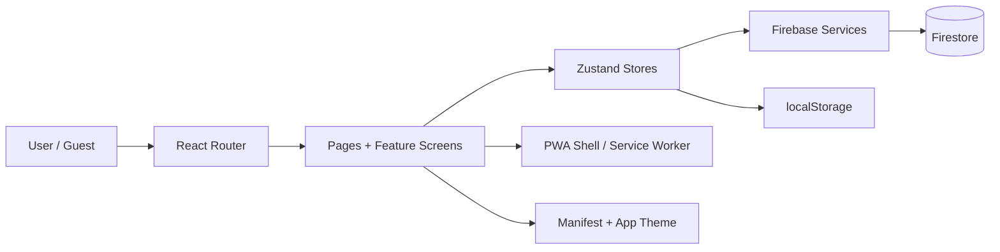

# LifeHub

> **Authoritative project reference:** [Master Source of Truth](docs/MASTER_SOURCE_OF_TRUTH.md) (v1.0.0, 2026-10-21). For AI sessions see the [AI-ready knowledge base](docs/AI_READY_KNOWLEDGE_BASE.md). This README is an introduction, not a competing policy or architecture authority. The DOCX reconciliation and live runtime/security checks remain open.

LifeHub is a personal life and finance workspace designed to help people keep track of meaningful moments, follow-up activities, financial records, and personal preferences in one place. The product blends life planning with lightweight money tracking, all inside a mobile-friendly web app.

## 1. Application overview

### What the application does

LifeHub helps a user manage:

- Life moments such as birthdays, anniversaries, festivals, travel plans, and personal milestones
- Follow-up tasks or actions connected to each moment
- Memories, notes, and attachments for meaningful events
- Income and expense records
- Reminder defaults and custom category lists
- Greeting-card style communications for celebrations
- A dashboard summarizing upcoming milestones and financial status

### Main business purpose

The app is built for personal life organization. It reduces the risk of forgetting important dates, keeps plans and memories connected to the same event, and makes it easier to track household or personal spending without needing separate tools.

### Target users

- Individuals managing personal life events
- Families tracking celebrations and recurring milestones
- People who want a simple dashboard for life and money in one place
- Users exploring a low-friction, app-like PWA on mobile or desktop
- Guest users who want a non-account trial before committing to a login

### Key modules

- Dashboard: summary view for upcoming life events and quick action access
- Events: create, edit, organize, and track important life moments
- Activities: tasks connected to each event
- Memories: notes and attachments tied to a moment
- Financials: income, expense, and balance overview
- Settings: custom list management, reminders, defaults, and exports
- Code Lists: editable category configuration for moments, incomes, expenses, and reminders
- Insights: higher-level reporting and review of stored information

## 2. Architecture overview

### Frontend architecture

The application is a React single-page app built with Vite. Routing is handled through `react-router-dom`, while shared state is coordinated by Zustand stores. The app is organized into routes, pages, layout shells, feature modules, and reusable UI elements.

### State management

The app uses a central `useAppStore` for user session state, preferences, admin lists, and toast notifications. Feature-specific stores such as `useEventStore`, `useExpenseStore`, and `useIncomeStore` manage data for each domain while keeping the UI responsive and consistent.

### Firebase usage

Firebase provides:

- Google sign-in authentication
- Firestore data storage for authenticated users
- Separation between user-owned records and guest-mode data
- Optional analytics support when the app is deployed in production

Firestore data is grouped under each user ID and then collected into logical data families such as `eventGroups`, `expenses`, and `incomes`.

### Routing

The router wraps the app in a protected route shell. Public routes allow login, while account-only access is enforced through `ProtectedRoute`. Nested routes support event workspaces, financial sub-pages, and settings flows.

### Data flow

- User actions trigger store updates
- Stores call service modules
- Services read and write to Firestore or localStorage
- UI screens render current store data and feedback messages

### PWA implementation

The app is installed as a progressive web app with a manifest, standalone display mode, and a service worker registration in production. The app also prompts users when a new version is available and supports a lightweight offline shell experience.

## 3. Developer guide

### Architecture diagram



### Data model overview

Key entities include:

- Event / Moment: a personal milestone or occasion
- Activity: a task or action connected to an event
- Memory: a note or attachment chronicling meaning behind an event
- Expense: a tracked outgoing amount with a category and date
- Income: a tracked incoming amount with a type and date
- Settings: user personalization such as theme, reminders, and defaults
- Code Lists: shared category definitions used across the app

### Screen overview

- LoginPage: entry point for authenticated users
- DashboardHome: landing page with overview and quick actions
- Events: central life-moment dashboard
- Financials: balance and income/expense summary
- Settings: admin and personalization controls
- CodeLists: custom categories and defaults
- About: product guidance and release information

### Folder structure

```text
src/
  components/
  context/
  dev/
  features/
  firebase/
  hooks/
  layouts/
  pages/
  routes/
  services/
  store/
  utils/
```

### Firebase structure

The expected user-owned data layout is:

```text
users/{uid}/
  eventGroups/
  expenses/
  incomes/
```

Guest-mode records are stored in browser localStorage, then merged into the authenticated account when the user signs in.

### PWA features

- Standalone installability
- Service-worker-based app shell updates
- Refresh prompt after new deployment
- Offline-ready shell behavior in supported browsers

### How new features are added

1. Add or update the route in the app shell
2. Create the screen or feature module under `src/pages` or `src/features`
3. Add or update the relevant Zustand store and service file
4. Use existing shared preferences and code lists wherever possible
5. Keep business behavior documented in comments and guide materials

### Deployment process

1. Build the app with `npm run build`
2. Run the deployment script through `npm run deploy:hosting`
3. Publish frontend changes to Firebase Hosting
4. Validate the PWA update flow and service worker versioning

### Troubleshooting guide

- If routes fail to load, check for a chunk-load error and confirm the browser cache is refreshed
- If data is missing after login, verify guest-to-account merge and Firestore access
- If guest settings do not persist, check the guest Code List key `lifehub_guest_admin_values` and `lifehub_preferences`; authenticated Code Lists load from Firestore at `users/{uid}/settings/codelists`. See [Code List persistence and migration](docs/CODE_LIST_PERSISTENCE.md).
- If a new version does not appear, verify service worker registration and cache versioning

## 4. Related documentation

- [docs/ARCHITECTURE.md](docs/ARCHITECTURE.md)
- [docs/DOCUMENTATION_STANDARDS.md](docs/DOCUMENTATION_STANDARDS.md)
- [BUSINESS_GUIDE.md](BUSINESS_GUIDE.md)
