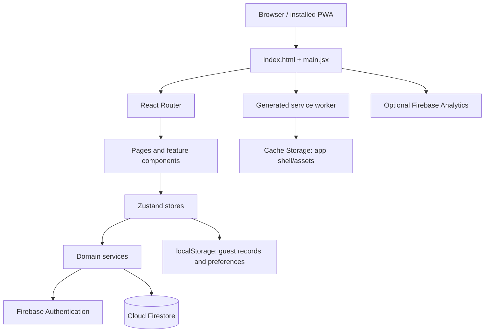

# Architecture — LifeHub

> **Branch:** `OldVersion`  
> **Repository:** `Divin-kumar/DN_APP_MAIN`  
> **Architecture baseline:** React/Vite SPA, Firebase Auth + Firestore, Zustand, localStorage guest/preferences, generated service worker.

## 1. System summary

LifeHub is a browser-rendered React single-page application. React Router controls navigation, Zustand stores hold global and domain state, service modules isolate persistence, Firebase supplies authentication and cloud records, and localStorage supports preferences and guest records. Vite builds the static app and generates the PWA service worker. Firebase Hosting serves the compiled `dist` directory and rewrites application paths to `index.html`.

There is no separately deployed application server or custom REST/GraphQL API in the inspected source. The browser calls Firebase SDK APIs directly.

## 2. Technology stack

| Area | Technology / evidence |
|---|---|
| Language | JavaScript ES modules; JSX; no TypeScript configuration observed |
| UI | React 18, React DOM |
| Build/dev server | Vite 5, `@vitejs/plugin-react` |
| Routing | `react-router-dom` 6 |
| State | Zustand 5 |
| Backend services | Firebase JS SDK 12: Authentication and Cloud Firestore |
| Authentication | Firebase Auth with Google provider |
| Motion | Framer Motion |
| Icons | Lucide React |
| Persistence | Firestore for account data; localStorage for guest data/preferences; service-worker Cache Storage for app shell |
| Testing | Node built-in test runner files (`*.test.mjs`); package scripts do not currently declare a test command |
| Hosting | Firebase Hosting, site configured as `dn-10` |
| PWA | Web manifest plus custom Vite build plugin that emits `sw.js` |
| Analytics | Optional Firebase Analytics, dynamically imported in production if supported |

Package scripts observed: `dev`, `build`, `preview`, and `deploy:hosting`. No lint, type-check, or test script is declared in `package.json`.

## 3. Repository layout

```text
.
├── public/
│   ├── manifest.webmanifest       # install metadata and app icon declaration
│   └── dn-icon.svg                # PWA icon
├── scripts/
│   └── deploy-hosting.mjs         # deployment helper
├── docs/
│   ├── ARCHITECTURE.md            # existing architecture notes
│   └── DOCUMENTATION_STANDARDS.md # existing documentation guidance
├── src/
│   ├── App.jsx                    # application composition and route setup
│   ├── main.jsx                   # bootstrapping, theme, analytics, SW registration
│   ├── index.css                  # global/base styles and legacy design tokens
│   ├── design-system.css          # current theme tokens and component/layout overrides
│   ├── components/
│   │   ├── common/                # connectivity, dates, dropdowns, loading, modal, sort
│   │   ├── events/                # event/activity forms, lists, summaries
│   │   ├── expenses/              # expense form/list/summary
│   │   └── income/                # income form/list/summary
│   ├── context/
│   │   ├── AuthContext.jsx        # auth listener and guest-data merge
│   │   └── GuestContext.jsx       # guest session transitions
│   ├── dev/
│   │   └── sampleData.js          # sample/demo data behavior
│   ├── features/
│   │   ├── dashboard/components/  # dashboard overview
│   │   └── events/components/     # event workspace shell
│   ├── firebase/
│   │   └── config.js              # Firebase app/auth/Firestore/Analytics setup
│   ├── hooks/                     # reusable sort and swipe-action hooks
│   ├── layouts/
│   │   └── DashboardLayout.jsx    # shared application layout
│   ├── pages/                     # route-level screens
│   ├── routes/
│   │   └── ProtectedRoute.jsx     # route gate
│   ├── services/                  # persistence, auth adapter, guest merge
│   ├── store/                     # Zustand app and domain stores
│   └── utils/                     # code lists, statuses, download, greetings, SW update
├── firebase.json                  # Hosting rewrites/headers
├── vite.config.js                 # Vite config and service-worker generation
├── package.json / package-lock.json
└── index.html                     # SPA HTML entry
```

Other repository-root materials include `BUSINESS_GUIDE.md`, product/system overview DOCX files, issue/bug evidence under `Bugs_OCT26/`, and a dated insights JSON export. Treat these as reference materials, not runtime modules.

## 4. Runtime architecture



### Startup sequence
1. Browser loads `index.html` and bundled entry assets.
2. `src/main.jsx` reads saved theme preferences and sets `document.documentElement.dataset.theme`.
3. React mounts under `React.StrictMode` and `BrowserRouter`.
4. App providers/listeners initialize authentication and guest state.
5. In production, analytics is initialized after window load when supported.
6. In production, the service worker is registered after window load and checked for updates.

### Navigation
- `BrowserRouter` provides client-side navigation.
- `ProtectedRoute.jsx` gates account routes based on application session state.
- Hosting rewrites unknown paths to `index.html`, allowing nested SPA URLs to load directly.
- Routes and lazy-loading details should be kept aligned with `src/App.jsx`.

## 5. State and persistence

### Store responsibilities
- `useAppStore`: user/session state, auth readiness, guest flag, preferences, code-list/admin values, app loading, and toast state.
- `useEventStore`: event CRUD, normalization/status handling, load de-duplication, optimistic updates, guest persistence, and sample-data integration.
- `useExpenseStore`: expense CRUD, load de-duplication, optimistic updates, guest persistence, and sample-data integration.
- `useIncomeStore`: income-domain state and persistence.
- `useDashboardStore`: dashboard-specific state (small store in current tree).

### Persistence matrix

| Data | Authenticated mode | Guest mode | Notes |
|---|---|---|---|
| Events and embedded activities/memories/attachments | `users/{uid}/eventGroups/{documentId}` | `lifehub_guest_eventGroups` localStorage key | Event data is normalized in `eventService.js` |
| Expenses | `users/{uid}/expenses/{documentId}` | `lifehub_guest_expenses`, plus nested activity expenses | Read path reconciles master and nested records |
| Income | `users/{uid}/incomes/{documentId}` | `lifehub_guest_incomes` | Normalized by `incomeService.js` |
| Preferences | Browser localStorage | Browser localStorage | Includes `lifehub_preferences` and theme choice |
| Code-list/admin values | Browser localStorage | Browser localStorage | Schema migration/version key is used |
| App shell/assets | Browser Cache Storage | Browser Cache Storage | Managed by generated service worker |

Authenticated collection reads/writes are performed by Firebase SDK calls in the browser. No custom API server or explicit REST endpoint layer was observed.

## 6. Data model

### Event / event group
Normalized event properties include:
- `id`, `name`, `date`, `type`, `customType`, `recurrence`, `budget`, `notes`
- `greetingCard` object with title/body/update timestamp when present
- `memories[]`, `attachments[]`, `activities[]`
- computed `status` and `createdAt`
- `firestoreId` added by the persistence adapter for cloud document identity

### Activity
Normalized activity properties include:
- `id`, `eventId`, `title`, `date`, `description`
- `expenses[]`, `completed`, `cancelled`, `priority`, `completedAt`, `createdAt`

Activities are embedded within event documents rather than represented by a dedicated top-level collection in the inspected service.

### Expense
- `id`, `name`, `amount`, `category`, `description`, `date`, `createdAt`
- optional `eventId`, `activityId`, and `source`
- optional `firestoreId` on records read from Firestore

Some activity expenses are embedded in an event document while top-level expense records are stored in the expenses collection. `expenseService.js` merges these sources and de-duplicates by ID/document identity.

### Income
- `id`, `name`, `type`, `amount`, `date`, `createdAt`
- optional `firestoreId` on Firestore records

### Preferences and code lists
Preferences are JSON stored in localStorage and merged with defaults on load. Code lists are initialized from defaults and migrated with a schema version. Keep historical values readable when values become inactive.

## 7. Service boundaries and data flow

- UI components call store actions rather than invoking Firestore directly.
- Store actions normalize input, update Zustand state, and call service functions.
- Service functions implement guest-local or Firebase persistence and normalize data returned from persistence.
- Authenticated create/update/delete paths often use optimistic updates and restore previous state on failures.
- Service functions log diagnostic errors; stores also expose user-friendly error state for many domain operations.
- **Guest-merge exception:** `AuthContext.jsx` catches/logs `mergeGuestDataIntoAccount` errors and updates the app-level user in `.finally()`. The inspected path has no visible merge-failure/retry UI, so a signed-in screen does not prove that guest data was migrated successfully.
- Event/expense data has cross-domain coupling: expenses may be nested in event activities and are reconciled for reporting.

## 8. PWA and deployment

### Build
- Vite uses the React plugin.
- `vite.config.js` reads the package version and constructs a build identifier.
- The build plugin finds entry chunks/imports and CSS assets, then emits `dist/sw.js`.
- Worker cache names are versioned; older caches with the same prefix are deleted on activation.

### Cache behavior
- Pre-cache includes root/index, manifest, icon, entry chunks/imports, and CSS.
- Navigations use network-first behavior with cached `index.html`/root fallback.
- Pre-cached URLs and eligible assets use cache-first behavior.
- Other same-origin JS/CSS/SVG/font assets may be cached after successful network fetch.
- This cache strategy supports the shell; it does not itself enable offline Firestore data writes.

### Hosting
- `firebase.json` serves `dist` and rewrites all paths to `/index.html`.
- Entry HTML, service worker, manifest, JS, and CSS receive no-cache headers.
- Hosting site is configured as `dn-10`.
- Deploy through `npm run build`, then `npm run deploy:hosting`; inspect the script before changing deployment behavior.

## 9. Security and operational boundaries

- Firebase UID path scoping is the client-side data organization model.
- Firebase Security Rules are not present in the inspected root tree; verify rules in Firebase Console or deployment configuration before asserting data isolation.
- Client route guards improve UX but are not authorization.
- Firebase client config is embedded in the frontend. Do not add admin/service-account secrets to client code.
- localStorage is origin-scoped and not a secure secret store.
- Analytics is optional and non-blocking.

## 10. Architectural risks and constraints

1. Large CSS files (`index.css`, `design-system.css`) overlap in token and component styling; cascade order matters.
2. Domain state is split between event documents and top-level financial collections; reconciliation must be maintained.
3. Sample-data mode adds another persistence path and needs isolated tests.
4. Guest merge must remain idempotent to avoid duplicates on repeated auth callbacks.
5. Browser-local guest data has no server backup until a successful merge/export path is used.
6. PWA shell caching can display a stale app if versioning/update behavior regresses.
7. Several large route/page components combine view logic and business rules; refactor incrementally with tests.
8. A package test script, lint script, and type checking are not configured in the observed package manifest.

## 11. Change protocol

For a new domain feature:
1. Confirm requirements and existing model shape.
2. Update normalization/service behavior first.
3. Add store actions with consistent loading/error/rollback behavior.
4. Implement reusable components and route integration.
5. Add tests for pure utilities and service normalization.
6. Validate guest and authenticated paths separately.
7. Run build and existing Node tests.
8. Check mobile/desktop layouts, both themes, and installed-PWA update behavior.
9. Update root documentation when architecture or user-visible behavior changes.


## 12. Settings backup export

The Settings > Data & Backup export produces a versioned JSON snapshot. It combines all app-prefixed `lifehub_*` localStorage entries with the effective records for `eventGroups`, `expenses`, and `incomes`. For authenticated sessions, the existing Firestore service readers fetch the current user's records; guest sessions read local guest records; active development sample mode exports its isolated sample dataset. Event documents include embedded activities, memories, attachments, and greeting-card data. Expenses are exported as the deduplicated effective list returned by the expense service, so activity-linked expenses may also be represented inside their parent event/activity.

Format v2 separates `data.localStorage` from `data.collections` and records source metadata. It must not include auth credentials or Firebase security rules. Restore first validates the file and asks for confirmation with a record-count preview. It restores app-owned `lifehub_*` settings while excluding guest-record/session/sample-fixture keys, then merges event groups, effective expenses, and incomes into the active guest store or the currently signed-in UID's Firestore collections using existing service functions. Legacy flat backup files remain supported for settings restore.

Restore is intentionally merge-only: records with matching app-level IDs are skipped rather than overwritten. Imported events retain embedded activities, memories, attachments, greeting-card data, and nested expenses. Nested expenses already represented inside restored/current event groups are not separately re-created in the master expenses collection. A partially completed restore can be retried; IDs successfully written in the earlier attempt should be skipped. The currently signed-in account is the destination, so importing another account's backup requires explicit user awareness. Development sample mode must be cleared first. The import is not atomic across all records; a failure can leave a partial merge, and the UI tells the user that retry is possible. Validate this behavior with real Firebase rules and runtime tests before production use.
