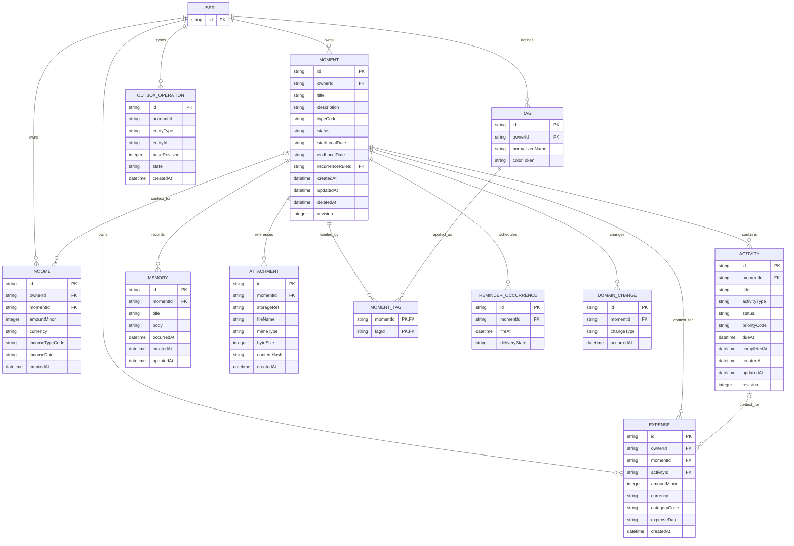
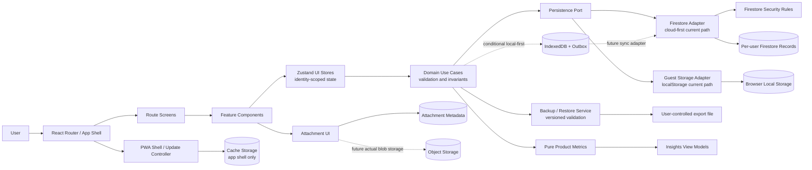
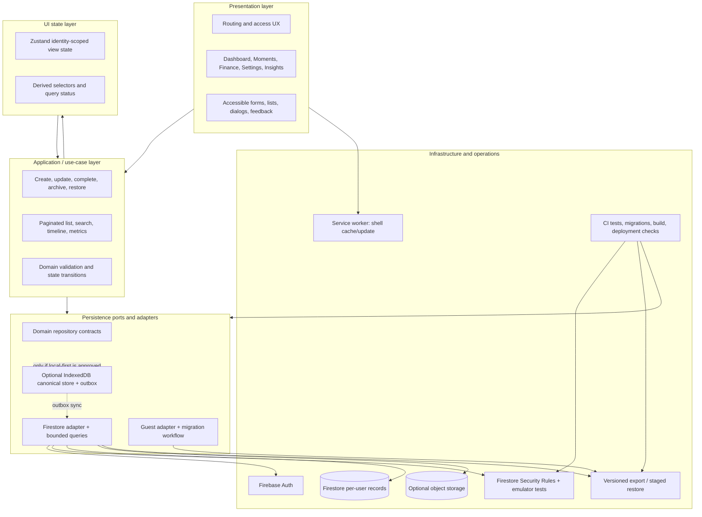

# DN / LifeHub — Enterprise Architecture Review

**Review date:** 2026-10-19  
**Review scope:** supplied DN product/system specification compared with the checked-out LifeHub implementation and repository documentation.  
**Review type:** source and documentation inspection; not a penetration test, live Firebase rules review, deployed-environment verification, or runtime performance test.  
**Decision posture:** do not treat the application as a dependable system of record for sensitive personal or financial data until the P0 controls in this document have been completed and independently verified.

> **Naming and truth-in-documentation note:** This workspace/repository, routes, storage keys, and Firebase project currently use “LifeHub”; the target product brief uses “DN.” This review uses **Moment** for the target domain concept and **event group/event** when describing the current persisted implementation. Resolve the product name and the canonical domain vocabulary before public documentation or a schema migration.

## 1. Executive summary

The application is a promising personal planning product with a conventional React/Vite frontend, route-level lazy loading, Zustand feature stores, Firebase Authentication/Firestore for account data, localStorage for guest data and preferences, and a service worker that caches the application shell. Those are workable choices for an early single-user product. The current design is not the architecture described by the supplied “current system” section: no application-owned IndexedDB persistence or general repository layer was found, authenticated writes go directly to Firestore from service modules, and guest data/preferences use localStorage. The app shell may load offline, but that is not equivalent to offline record creation or durable local-first synchronization.

The most serious risks are data correctness and recovery, not framework selection:

1. **Authorization is unverified.** No Firebase Security Rules source or emulator/rules tests were found in the workspace. Client-side route protection and UID-scoped paths do not establish access control.
2. **Account switching can expose stale state.** Event and expense stores do not visibly clear previous account records as the next account loads. This requires an immediate fix and regression tests.
3. **Guest-to-account migration is not proven safe.** It uses one batch, random target IDs and clears guest data after commit; failure is logged but does not block the signed-in transition or expose a retry workflow. Large imports can exceed the batch write limit; ambiguous retries may duplicate records.
4. **Financial data has split ownership.** Expenses may be embedded in activities/events and independently persisted in an expenses collection. A nested-only cloud expense can disappear from store state without being deleted from its parent event record, then reappear after reload.
5. **Backup/restore is useful but not a dependable recovery guarantee.** Restore is merge-oriented and non-atomic; partial application, weak record-level validation, ambiguous future versions, and sensitive/localStorage export scope require hardening.
6. **Attachments are not files.** The event workspace records selected file name/type/size/date metadata, but the selected file bytes are not uploaded or retained. User-facing “stored keepsakes” language is misleading until storage is implemented.
7. **Several roadmap items are not present.** There is no global search index, domain-wide event timeline, reminder scheduler, actual attachment store, or robust local-first outbox. The existing timeline is activity-oriented.

**Architecture direction:** keep the single Moment concept as the user-facing organizing principle, but do not force every domain concept into one aggregate document or one generic schema. Use normalized records and stable IDs for independent data, explicit links from financial entries to moments where applicable, actual attachment objects separated from attachment metadata, and a deliberately selected consistency model. First deliver correctness, authorization, backup recovery and release tests. Then decide—through an architecture decision record—whether the product is (a) cloud-first with explicit offline limitations, or (b) local-first with a durable IndexedDB store/outbox and remote synchronization. Do not describe the current implementation as fully offline-first until the latter behavior is implemented and tested.

### Scope limits and confidence

This review is grounded in the source and documentation currently present, including [docs/ARCHITECTURE.md](ARCHITECTURE.md), [tasks.md](../tasks.md), [src/services/eventService.js](../src/services/eventService.js), [src/services/expenseService.js](../src/services/expenseService.js), [src/services/guestMergeService.js](../src/services/guestMergeService.js), [src/context/AuthContext.jsx](../src/context/AuthContext.jsx), [src/store/useEventStore.js](../src/store/useEventStore.js), [src/store/useExpenseStore.js](../src/store/useExpenseStore.js), [src/features/events/components/EventWorkspaceShell.jsx](../src/features/events/components/EventWorkspaceShell.jsx), and [package.json](../package.json). Findings say “not found” where the review inspected this workspace and did not locate an implementation; that is not proof that an external Firebase Console configuration or an untracked system does not exist. No deployed rules, security posture, browser quota behavior, real device UX, production traffic, or restore drill was validated.

## 2. Architecture review

### 2.1 Current implementation versus stated design

| Concern | Supplied description | Verified in workspace | Review finding |
|---|---|---|---|
| Core user concept | Moment | Persisted model is an Event/event-group document with `name`, `date`, `type`, `notes`, recurrence, budget, memories, attachments, and activities | Product concept can remain Moment; do not assume renaming the UI concept equals a safe persisted schema change. |
| Presentation | React app/screens | React/Vite SPA, React Router, lazy route screens | Appropriate for present product scale. Large screens/workspaces warrant incremental component extraction. |
| State | Stores | Zustand domain stores | Reasonable choice; stores currently carry identity/loading/persistence policy and optimistic rollback concerns. |
| Repository | UI → store → repository → IndexedDB | UI → store → service → Firestore or localStorage; no owned IndexedDB/repository abstraction found | Docs must be corrected. Services are adapters but tightly coupled to Firebase imports. |
| Authenticated persistence | IndexedDB/local-first | Firebase Auth and Firestore client calls | Firestore is the remote source; no app-level durable offline queue found. |
| Guest persistence | Local | localStorage guest records | Simple and useful for small guest datasets, but synchronous, quota-limited, and unsafe as durable file storage. |
| PWA | Offline-first | service worker caches shell/static assets; connectivity UI reports cloud limitations | Offline shell is not offline data capability. |
| Attachments | Files/repository | Only attachment metadata is saved | Product behavior and data model disagree. |
| Backup | Complete application data | Versioned export/import exists; import is merge-style and non-atomic | Valuable foundation, but “complete” and “recovery” require stronger invariants and tests. |
| Identity | User | Firebase user plus guest/sample modes | Multiple modes amplify data isolation and test matrix size. |
| Finance linkage | Independent financial records / Moment links | Top-level expenses plus nested activity expenses | Duplicated ownership and asymmetric mutations are correctness hazards. |

### 2.2 Moment-centric approach and boundaries

**Recommendation:** retain Moment as the primary navigation and aggregation concept, but model domain records according to their lifecycle and query requirements.

- A Moment is a user-owned planning/meaning container: title, narrative, type, lifecycle status, planned date range, recurrence rule, and timestamps.
- Activity is an independently changing action with its own workflow and due date. It may belong to one Moment; do not create Task/Bug/Reminder tables unless their requirements genuinely diverge. Use a typed Activity plus optional typed detail only when needed.
- Memory is a narrative entry with `occurredAt` (the remembered event time) distinct from `createdAt` and `updatedAt`.
- Attachment is metadata plus a durable `storageRef`; bytes belong in a binary/object store, not an ever-growing Moment document or JSON backup.
- Income and Expense are financial transactions with their own lifecycle and categorization. A nullable `momentId`/`activityId` relationship is useful when a transaction relates to a Moment; finance must still work independently.
- Tags are cross-cutting labels. Moment tagging may be v1; avoid generalized tagging of every entity until concrete use cases and search UX justify it.

A universal container is a good product abstraction, but it becomes a modeling anti-pattern if every typed workflow is squeezed into free text, nullable columns and code-list values. Diary journaling, health measurements and pregnancy milestones may need specialized structured values, privacy controls, units, and retention policies. Keep the Moment as their parent/context and add typed extension records only where the workflow needs structured queries. Do not make Moment type a substitute for a data schema.

**Trade-off:** a normalized model increases reads and joins/aggregation work compared with embedded arrays, but avoids growing aggregate documents, reduces overwrite conflicts, enables pagination, and supports independent lifecycles. For a personal application, this is worthwhile for activities, memories, financial records, and attachments once data growth or concurrent clients matter. Small fixed metadata may stay embedded.

### 2.3 Findings by required quality attribute

- **Normalization:** expense duplication is a current normalization/integrity defect. Nested arrays for memories, activities and attachments couple independent updates to a whole event document. Normalize independently edited, unbounded or searchable records. Keep display-only summaries derived rather than duplicated unless profiling warrants a materialized projection.
- **Denormalization:** denormalize small immutable display snapshots only for a measured query/performance need. Include source IDs and update/version rules. Never silently maintain two authoritative expense copies.
- **Naming:** settle on Moment (domain), `momentId`, `occurredAt`, `createdAt`, `updatedAt`, `deletedAt`, `status`, `typeId` or a documented stable code. Avoid mixing Event/Moment, date/createdAt, `completed` booleans plus string statuses, and `firestoreId` as domain identity. Keep provider IDs inside persistence adapters.
- **Scalability:** unpaginated full collection reads and embedded arrays are O(total account data) in network, memory and rendering. Expense reads fetch all events to discover nested transactions. Bound each page/query and move high-growth records to independently queried collections/subcollections. Add indexes based on actual queries and measure read/write costs.
- **Maintainability:** feature modules exist, but the route/workspace and pages combine UI/business behavior. Add pure domain functions and service boundaries incrementally with behavior tests. Do not undertake a broad rewrite before correcting ownership and safety invariants.
- **Extensibility:** code lists support labels and user configuration, not arbitrary schema/workflow customization. Persist stable codes/IDs and snapshot or retain inactive labels for historical records. Add a validation layer so changing a list cannot invalidate prior records.
- **UX:** consistent loading/error/empty states, accessible keyboard/focus, small-screen forms, recovery after failed sign-in migration, honest attachment/offline claims, and destructive-operation safeguards are product requirements, not polish. Test installed-PWA update behavior as well as responsive browser layouts.
- **Operational readiness:** package scripts define build/deploy but no test/lint/type-check release command; existing Node tests cover selected utilities. Add CI gates and recovery/rules test suites before feature expansion.

### 2.4 Recommendation register

The complexity scale is relative: **S** = small isolated change; **M** = moderate, cross-layer change; **L** = multi-release/data migration or new platform capability. “Now” means before claiming production readiness; “later” means after P0/P1 correctness; “never” means avoid absent a compelling requirement.

| Recommendation | Why | Benefits | Risks / trade-offs | Complexity | Timing |
|---|---|---|---|---|---|
| Verify Firestore rules with emulator tests and deployed-project review | Client path scoping is not authorization | Prevents cross-user exposure and unauthorized writes; gives a repeatable security contract | Incorrect restrictive rules can block users; deployment drift remains possible | M | **Now / P0** |
| Clear or identity-scope event and expense state before account transition | Previous user data can remain visible while new account data loads/fails | Prevents cross-account disclosure and misleading UI | Brief empty/loading flicker; race handling needed | S–M | **Now / P0** |
| Select one source of truth for each expense; repair nested-only update/delete | Duplicate ownership produces stale/reappearing financial records | Correct totals and dependable deletion | Migration must reconcile conflicts; users may have duplicate historical data | M | **Now / P0** |
| Make guest migration idempotent, chunked, resumable, and user-visible | Random IDs/single batch and silent error path are unsafe for retries/large data | No lost/duplicated guest records; clear completion/failure UX | More migration state and support paths | M–L | **Now / P0** |
| Validate deployed backup recovery with malformed, partial, retry, and large fixtures | Export/import is not an atomic snapshot and validation is limited | Recovery confidence and safer device migration | Strict validation may reject old records; compatibility work required | M | **Now / P0** |
| Declare real offline behavior accurately and choose cloud-first vs local-first | Shell cache does not persist offline business writes | Aligns product promise and implementation; avoids lost-work assumptions | Local-first adds sync conflicts, storage/quota and account-encryption concerns | S for claim correction; L for local-first | **Now decision; implementation later** |
| Store attachment bytes and metadata separately, or remove upload promise | Metadata-only records cannot restore/view original files | Functional keepsakes, bounded DB documents, explicit storage lifecycle | Cost, quotas, privacy, upload failures, orphan cleanup | L | **Later, after product decision** |
| Normalize high-growth independently queried records | Embedded arrays cause whole-document writes, size ceilings and conflicts | Pagination, scalable search, independent updates | Migration complexity; more reads and query/index design | L | **Later, gated by growth/feature needs** |
| Add automated tests/release checks for auth, CRUD, rules, backup, and migrations | Utility-only tests do not prove data journeys | Regression containment and production evidence | CI maintenance and emulator setup | M | **Now / P1** |
| Add global search, dynamic cross-domain timeline, and richer analytics | These are product roadmap features, not current capabilities | Better retrieval and reflection | More indexing, privacy and consistency surface; can distract from safety | M–L | **Later** |
| Create separate top-level entities for every Moment type (Diary, Project, Pregnancy, Bug) | Duplicates common lifecycle and navigation without demonstrated need | Could support specialized schemas if justified | Fragmented UX, duplicated CRUD/permissions and migrations | L | **Never by default; only for divergent domain needs** |
| Build custom backend/microservices now | Current scale and product needs do not justify it | More control if server-side workflows/consumers become necessary | Operations, cost, security and availability burden | XL | **Never now; revisit only with evidence** |
| Store file blobs/base64 inside Firestore Moment docs or JSON backups | Document limits and backup size make this unsafe | None that outweighs risks | Size limits, latency, costs, quota, export bloat | M | **Never** |
| Treat client-side route guards as security | They do not protect the data service | None | False assurance | S | **Never** |

Additional cross-cutting recommendations use the same assessment dimensions:

| Recommendation | Why | Benefits | Risks / trade-offs | Complexity | Timing |
|---|---|---|---|---|---|
| Define stable domain IDs, date/time semantics, currency representation, and one canonical vocabulary | Current normalizers mix domain and provider identity and use loosely specified dates and numeric amounts | Safer migrations, deterministic deduplication, accurate finance and timezone behavior | Requires backward-compatible conversion and can reveal malformed legacy data | M | **Now, before schema expansion** |
| Add explicit record ownership, lifecycle, deletion, and historical-value rules | Embedded data and configurable code lists leave cascade, restore, and retired-value behavior implicit | Predictable CRUD, recoverable deletes, valid historical reports | Soft deletes and history add retention/storage responsibility | M | **Now for ownership/delete policy; later for full audit history** |
| Paginate cloud reads and add query-specific indexes | Full-collection reads grow with account size and cost | Bounded latency, memory and read cost; predictable mobile behavior | Cursor/state complexity; incorrect filters can omit records | M | **Now for unbounded reads; refine from telemetry** |
| Approve one explicit persistence consistency model | Mixing guest-local, cloud, caches and a proposed IndexedDB layer without authority rules invites lost/duplicated writes | Clear user promise and implementable correctness invariants | Local-first adds sync, conflict, quota and support burden | M for ADR; L for local-first | **Now decision; local-first only if required** |
| Implement outbox, revisions, tombstones and conflict UX before local-first sync | Network retries and multi-device edits can reorder or duplicate operations | Safe retries, deletion propagation and explicit conflict resolution | Significant complexity; tombstone retention and conflict UX require maintenance | L | **Later, only after local-first is approved** |
| Separate binary attachment storage from metadata and define retention/backup policy | Current attachment selection persists metadata only; large blobs do not belong in event documents | Original files become retrievable and backup behavior becomes honest | Storage cost, upload security, orphan cleanup, quota and privacy risks | L | **Later, following storage/product decision** |
| Implement global search as a rebuildable derived index | Firestore composite indexes are not full-text search; current filters are screen-local | Cross-domain discoverability without another source of truth | Index drift, privacy leakage, query cost and deletion obligations | M–L | **Later, after canonical records/pagination** |
| Define timeline as either occurrence feed or audit history | Mutable current fields cannot reconstruct historical state transitions | Coherent chronological product without false audit claims | Audit history adds writes/retention; derived feed may require query fan-out | M for derived feed; L for audit | **Later, before calling it dynamic timeline/history** |
| Specify each insight formula and separate it from telemetry | Ambiguous metrics and sensitive event content can cause misleading reports or privacy exposure | Reproducible, testable summaries with minimized telemetry | Metric definitions can disappoint users; aggregation still has scale/currency limits | M | **Later, before expanding Insights** |
| Model recurrence templates, occurrences, and reminder delivery limitations explicitly | A recurrence label cannot represent exceptions, completion, DST, or reliable notification delivery | Correct future occurrences and honest reminder UX | Timezone edge cases; server push may be needed for reliable delivery | L | **Later, before shipping recurring reminders** |
| Gate pregnancy/health tracking on privacy and threat-model approval | Health-related records are more sensitive and can invite medical reliance | Minimizes sensitive-data collection and clarifies non-clinical limits | Slows feature delivery; legal obligations vary by market and claims | M for assessment; L for feature | **Later, only after review** |
| Add accessibility/mobile and operational release gates for core journeys | Responsive appearance alone does not prove usable forms, restore, or installed-PWA behavior | Fewer data-entry failures and stronger release confidence | Test matrix and device/browser maintenance cost | M | **Now for core journeys; continuous thereafter** |

## 3. Data model review

### 3.1 Recommended logical model

Use application-generated stable UUIDs for domain IDs across guest, backup and cloud modes. Use provider document IDs as adapter metadata only. Store instants in ISO UTC timestamps and calendar-only values (`dueDate`, `localDate`) as explicit date-only strings; do not silently reinterpret a local date as midnight UTC. Money should be integer minor units plus a currency code, not floating-point `Number`/Firestore decimal assumptions. If only one currency is supported in the near term, still persist the ISO currency code and make that product constraint explicit.

**Target records:**

- **Moment:** `id`, `ownerId`, `title`, `description`, `typeCode`, `status`, `startAt`/`startLocalDate`, `endAt`/`endLocalDate`, recurrence reference/rule, `createdAt`, `updatedAt`, optional `deletedAt`, `revision`.
- **Activity:** `id`, `momentId`, `title`, `description`, `activityType`, `status`, `priorityCode`, `dueAt`, `completedAt`, timestamps, optional deleted marker and revision. Status is a single enum/state machine; do not mix booleans with status strings.
- **Memory:** `id`, `momentId`, `title`, `body`, `occurredAt`, `createdAt`, `updatedAt`, `visibility`/sensitivity when required.
- **Attachment metadata:** `id`, `momentId`, optional activity/memory association, original filename, MIME, byte size, content hash, storage provider/reference, created timestamp, upload state, encryption/key metadata if encrypted. Blob lifecycle and metadata lifecycle must be explicit.
- **Income / Expense:** `id`, owner, amountMinor, currency, date/time, category/type stable code, description, optional `momentId`/`activityId`, source, timestamps, revision/deletion state. Exactly one persisted canonical transaction record.
- **Code list item:** stable ID/code, list type, label, active flag, sort order, schema version/timestamps. Historical records should retain a resolvable code/label when an item is retired.
- **Tag / MomentTag:** stable tag ID, owner, normalized name, color token (not arbitrary CSS), created timestamp; unique owner+normalized-name; junction unique on moment+tag.
- **Reminder:** do not create one merely for a preset. Model a concrete scheduled reminder/occurrence separately from reusable reminder preferences if persistent scheduling and completion/snooze are required.
- **Sync operation/outbox entry:** client-generated operation ID, entity type/id, operation, base revision, payload/schema version, creation time, retry state. This is infrastructure state, not business history.
- **Audit/history:** append-only business event/change record only when user-visible history, recovery, or compliance needs justify it. A sync outbox is not an audit log.

### 3.2 Missing entities and entities to avoid

**Missing or underspecified:** a first-class recurrence rule/occurrence model; concrete Reminder occurrence and delivery state if reminders are promised; currency and transaction state; attachment binary/storage lifecycle; sync/outbox metadata if local-first is chosen; explicit soft-delete/tombstone policy for sync; ownership/tenant scope in the domain boundary; and an event/change record if user-visible audit history is required. Add health observations (measurement type/value/unit/time/source) or pregnancy milestone data only when those workflows are validated—not as arbitrary strings on Moment.

**Avoid now:** separate Diary, Project, Journey, Bug, Task, Checklist and Reminder entities solely because they are labels. Keep typed Activities until one type needs substantially different invariants, UI, permissions or query patterns. Avoid generic `CustomField`/form-builder schemas, plugin systems and generalized workflow engines before use cases demand them. Avoid duplicating expense data in activity arrays. Avoid a second event-log table whose only purpose is to render a timeline that can be derived from existing data.

### 3.3 Workflow designs

- **Moment lifecycle:** Draft (optional) → Planned/Active → Completed/Archived; Cancelled is terminal or restorable according to a documented policy. Keep status distinct from date-derived upcoming/past labels. Editing a date must not accidentally change completion state.
- **Diary:** user creates/chooses a Diary-type Moment (optionally persistent or one per journal collection), adds Memory entries with `occurredAt`, optional tags and actual attachments. Journal entries should be independently searchable, exportable and deletable; a single growing Moment array is not an adequate diary database. Offer lock/privacy expectations honestly; client-side visibility is not encryption.
- **Project:** Moment is project container; Activities have Task/Bug/ChecklistItem classification, statuses, priorities, due dates, and links/dependencies only if needed. Project-specific milestones remain Moments or typed Activity until a distinct lifecycle is proven. A board/list view is a projection over records, not a new database entity.
- **Bug tracking:** Activity type `bug` with workflow Open → In Progress → Testing → Closed (allow reopen). Store severity separately from priority; require reproducible description/expected vs actual only for bug type. Provide transition timestamps and history if workflow accountability is needed. Do not claim “Testing” using current Open/Completed/Cancelled fields without migration/UI support.
- **Pregnancy tracking:** use a Pregnancy Journey Moment with consent-sensitive structured milestones/appointments as Memories or typed records. Avoid inferring medical facts or presenting this as medical guidance. Provide privacy/export/delete controls and deliberate retention. If dates/gestational calculations are added, document source date, timezone/calendar semantics, and that estimates are not clinical advice.
- **Health tracking:** Moment may group a health journey; actual measurements need typed value, unit, measurement time, source/device, and optional notes. Validate allowed ranges as plausibility warnings, not diagnosis. Health data is highly sensitive; do not collect without a clear security/privacy case. Defer until access controls and encryption/retention assessment are complete.
- **Recurring events:** persist rule (frequency, interval, weekdays/monthly policy, timezone, start, optional end/count, exceptions) separately from occurrence. Generate occurrences deterministically for a bounded horizon or on query; persist exceptions/completions per occurrence. Never rewrite the original event date to “next occurrence,” because history and user edits become ambiguous. Test daylight-saving boundaries, leap dates, and moved/cancelled occurrences.
- **Reminders:** separate a preference/preset (lead time and channel) from an occurrence schedule (target entity/occurrence, fire time, state, snooze). Browser notifications require permission and may not run reliably when the PWA is closed; provide in-app fallback and never promise delivery guarantees without a server/push service. For device-only reminders, show platform limitations and recompute schedules after edits/timezone changes.

## 4. Database design review

### 4.1 Actual database and architecture gap

The current application does **not** implement the described IndexedDB layer. Signed-in records are stored in Firestore under per-user collections; guest records/settings/code lists are in localStorage; Cache Storage holds app assets. Current services import Firebase SDK methods directly, so “repository layer” is not yet a provider-neutral repository abstraction. The distinction matters: Firestore persistence/offline behavior must be intentionally configured and tested, while localStorage is not a reliable database for large or critical records.

### 4.2 Recommended target persistence options

Record an ADR before adding more roadmap features:

**Option A — cloud-first (lower complexity):** Firestore remains canonical; explicitly support read-only/limited offline UX unless Firestore persistence is configured, supported, and proven for target browsers. Use stable IDs, transactions/batches where atomicity is required, paginated queries, rules and versioned backup. Guest mode remains local and migration is resumable. This is the lower-risk near-term path.

**Option B — local-first (matches product promise, higher complexity):** IndexedDB/Dexie is the immediate local source of truth; all UI writes commit locally first, update UI, and add idempotent operations to an outbox. A sync adapter reconciles remote revisions and tombstones. Firestore is a remote replica/transport, not a second uncontrolled source of truth. Keep user identity and account switching explicit; partition local data by account and encrypt local sensitive content if the threat model requires it. A browser database is not a cross-device backup.

**Recommendation:** adopt Option A for immediate stabilization and do not make new offline-first claims. Make the Option B decision after threat model, product requirements and conflict semantics are agreed. If seamless offline editing is a committed requirement, choose B before global search, recurring workflows, or analytics, because those features depend on persistence semantics. Do not casually combine Firestore's client cache, custom IndexedDB, localStorage and an outbox without naming the authority and replay semantics for each record.

### 4.3 Firestore query/index plan (current cloud-first path)

Indexes are driven by screens and bounded query shapes. Start with these composite indexes only where Firestore query constraints require them; verify with emulator and query plans/cost observations. Per-user path provides owner partitioning but does not remove the need for rules.

| Collection/query shape | Candidate index / constraint |
|---|---|
| `users/{uid}/moments`: status + start date, sorted by start date | `status ASC, startLocalDate ASC` (or status + timestamp field actually used) |
| `moments`: type + start date, sorted | `typeCode ASC, startLocalDate ASC` |
| `activities`: moment ID + status + due date | `momentId ASC, status ASC, dueAt ASC` |
| `activities`: status + due date across user | `status ASC, dueAt ASC` |
| `memories`: moment ID + occurred date descending | `momentId ASC, occurredAt DESC` |
| `expenses`: date descending; category + date | `expenseDate DESC`; `categoryCode ASC, expenseDate DESC` |
| `income`: date descending; type + date | `incomeDate DESC`; `incomeTypeCode ASC, incomeDate DESC` |
| `attachments`: moment ID + created date | `momentId ASC, createdAt DESC` |
| `momentTags`: tag ID + moment ID / reverse lookup | both directions if tag and moment query paths are needed |

Use cursor pagination and stable sort tie-breakers (`id`). Avoid querying all event groups just to discover nested expenses. Firestore does not provide general full-text search; do not claim that a Firestore composite index is a search engine.

### 4.4 IndexedDB index plan if Option B is approved

If Dexie/IndexedDB becomes the local canonical store, define versioned object stores and indexes before migration. Example logical schema (field names must match finalized model):

- `moments`: primary `id`; indexes `[ownerId+status+startLocalDate]`, `[ownerId+typeCode+startLocalDate]`, `[ownerId+updatedAt]`, `[ownerId+deletedAt]`.
- `activities`: primary `id`; indexes `[momentId+status+dueAt]`, `[ownerId+status+dueAt]`, `[ownerId+updatedAt]`.
- `memories`: primary `id`; indexes `[momentId+occurredAt]`, `[ownerId+occurredAt]`, `[ownerId+updatedAt]`.
- `attachments`: primary `id`; indexes `[momentId+createdAt]`, `[ownerId+uploadState]`; blob storage only if browser quota strategy and lifecycle are implemented.
- `expenses`: primary `id`; indexes `[ownerId+expenseDate]`, `[ownerId+categoryCode+expenseDate]`, `[momentId+expenseDate]`, `[activityId]`.
- `income`: primary `id`; indexes `[ownerId+incomeDate]`, `[ownerId+incomeTypeCode+incomeDate]`.
- `tags`: primary `id`; unique `[ownerId+normalizedName]`.
- `momentTags`: primary compound `[momentId+tagId]`; reverse index `[tagId+momentId]`.
- `outbox`: primary operation ID; indexes `[state+createdAt]`, `[entityType+entityId]`, `[accountId+createdAt]`.

Do not index large free-text fields or binary blobs. IndexedDB indexes support filtering and ordering, not arbitrary text retrieval. Add only indexes backed by real queries: each index has write, storage and upgrade cost. Use bounded queries and cursor pagination; test quotas, private browsing, browser eviction, schema upgrades and failed migrations.

### 4.5 Migration strategy

1. Define schema versions for application records and backup envelopes independently; document the supported range.
2. Keep pure, deterministic migration functions with fixtures for every released schema. Preserve unknown fields when safe or reject with an actionable report; never silently reinterpret data.
3. For current Firestore data, export a dry-run inventory, detect duplicate IDs and nested/master expenses, and generate a reconciliation report. Resolve canonical expense ownership before moving records.
4. Migrate in idempotent, bounded batches with stable destination IDs, checkpoints and retry-safe writes; do not delete source data until counts/hashes and restore validation pass.
5. Migrate localStorage guest data with the same semantics and retain a recoverable source snapshot until the user confirms success.
6. For a future IndexedDB schema, use native/Dexie versioned upgrades with explicit blocked/versionchange UX and test upgrade from every supported version. Avoid an upgrade that requires network availability.
7. Run old/new application compatibility tests during rollout; version backups separately from database records.

## 5. State management review

Zustand is adequate; the concern is session scoping and responsibility boundaries. Stores currently coordinate view state, loading de-duplication, optimistic updates, sample data, guest-vs-auth branching, and persistence calls. Keep Zustand as UI state, but move validation/domain transitions into pure domain functions and persistence-specific behavior into adapters/use-case services.

**Immediate rules:** partition state by authenticated UID/guest/sample mode; on identity change, synchronously clear protected domain data before starting a new load; ignore stale asynchronous responses via request identity/cancellation; expose load failure separately from empty results; avoid rendering stale data on failures; make optimistic rollback mutation-specific so one failed request does not overwrite a newer change; normalize records at the service boundary. Add tests for account A → account B, sign-out → guest, failed load, overlapping load, and late response.

Do not duplicate server state in several stores unless ownership and invalidation are explicit. Dashboard and Insights should derive data from normalized repositories/selectors or maintained projections, not create independently mutable copies. Store selectors should avoid recomputing full reports on every render.

## 6. Repository/service review

The current service files provide a useful starting boundary, but directly import Firebase and choose localStorage based on mode. Rename the architecture accurately: **domain store → service adapter → Firebase/localStorage**. A real repository abstraction is justified when more than one persistence implementation must obey the same contract or tests need to substitute storage.

Recommended service contract per domain: `list(query, cursor)`, `get(id)`, `create(record)`, `update(id, patch, expectedRevision)`, `delete(id)`, plus import/export operations at a dedicated backup boundary. Return typed domain errors rather than raw SDK errors. Use stable app-generated IDs. Define expected error and retry semantics. Do not call a function `delete` if it only removes a projection in memory.

Before adding abstractions, fix the expense ownership defect and add contract tests. Avoid premature “generic repository for all entities”: Firestore and IndexedDB query semantics differ, and a lowest-common-denominator interface can conceal important transaction/pagination behavior. Keep provider-specific capabilities explicit where they matter.

## 7. Search design

Current activity/event/insight filtering is screen-local; there is no cross-domain full-text index. Recommended staged approach:

1. Define searchable fields and result contract: entity kind, stable ID, title/snippet, parent Moment, date, route, update timestamp. Exclude attachment binary content initially.
2. Normalize text with locale-aware case folding, Unicode normalization and tokenization. Decide accent/substring/prefix semantics, privacy scopes, and result limits.
3. For small cloud-first accounts, fetch bounded/paginated domain results and use client-side filtering only where datasets are demonstrably small. Do not fetch every account document for every search keystroke.
4. For local-first, build an IndexedDB-backed search index or query in-memory normalized text only for bounded datasets. Incrementally update/delete index entries transactionally with source records; perform full rebuild after schema upgrade.
5. For cloud-scale full text, use a dedicated search service only after the business need and privacy/cost constraints justify it. Firestore is not a full-text search provider.
6. Index only user-owned content; make deletion and backup/restore update the index. Provide debouncing, keyboard accessibility, filters, loading/empty/error states, and clear privacy/retention behavior.

**Do now:** define the UX/data contract and search privacy. **Do later:** global index after normalized collections and persistence choice. Do not add SearchIndex as a second authority; treat it as rebuildable derived data.

## 8. Timeline design

The existing “Timeline” route is an activity-focused view, not a global event history. A true Moment timeline can be derived from records with meaningful timestamps: Moment created/started, Activity created/completed/status changed, Memory created/occurred, Attachment added, linked Income/Expense recorded. Decide whether it means “things happened” (occurred timestamps) or “things changed in the app” (audit timestamps); these are different products.

For small datasets, compose a bounded window of source queries, map into a common read model, deduplicate by stable event identity, and sort by `(occurredAt DESC, id DESC)`. Preserve the source entity reference and route. A status transition timeline needs append-only change events or a durable audit record; current mutable status fields cannot reconstruct prior transitions. Do not store a duplicate timeline table just to sort existing records. Add materialized timeline projections only if measurement shows query fan-out/latency is unacceptable, and make them rebuildable.

**Risks:** ambiguous timezones, edits changing historical appearance, deleted source items, duplicate derived events, and query fan-out. Define display timezone, source deletion policy, and event identity. Pagination must use a stable compound cursor.

## 9. Insights and analytics design

Keep **product insights** (user-visible summaries) separate from **telemetry analytics** (usage events sent to a vendor). Product insights should be deterministic, local/account-scoped calculations with explicit date range, currency and timezone. Telemetry must be opt-in/consented as required, data-minimized and never include titles, memory bodies, descriptions, health/pregnancy details, or transaction descriptions.

Recommended architecture: normalized source records → pure metric functions → query/aggregation service → cached derived view model → accessible charts/tables with a textual equivalent. Metrics should define denominators and edge cases: completed activity means status completed; “most active month” counts a specified event type; net savings includes a stated income/expense date range and currency; most documented Moment can use memory count with deterministic tie-breaks. Never treat missing records as zero if loading failed.

For the current expected personal scale, compute on demand over bounded records and memoize; avoid a separate analytics database. If growth justifies pre-aggregation, build idempotent/rebuildable projections and compare them against source-derived totals. Do not claim financial advice or medical insights. Add tests with boundary months, no data, mixed currencies, deleted records and timezone transitions.

## 10. Sync design

Google Drive JSON backup is **not synchronization**. It lacks concurrent mutation, per-record merge, deletion propagation, retry semantics and server-side conflict detection. No custom backend is needed merely to add sync, but cross-device local-first sync is a substantial distributed-systems feature.

If Option B is approved, specify before coding:

- Each mutation has stable operation ID, entity ID, account ID, schema version, base revision and causation timestamp.
- Local commit and outbox enqueue are atomic in IndexedDB.
- Push is idempotent; retry/backoff is bounded; permanent authorization/schema errors are surfaced.
- Remote change feed/cursor advances only after local transaction commit.
- Deletes use tombstones until all relevant devices have observed them; hard deletion follows a retention policy.
- Per-entity revisions/ETags or server transactions detect concurrent edits.
- Background sync is an optimization, not a guarantee; foreground resume performs reconciliation.
- Account switch pauses sync, clears UI state, and never replays one account's outbox under another UID.

**Conflict policy:** transactions (income/expense) are immutable by default; corrections are edits with revision check or reversal records, not silent last-write-wins. For Moment/Activity/Memory metadata, use optimistic concurrency and show a conflict-resolution UI with both versions; merge disjoint fields only when deterministic and safe. Rich text body conflict merge is complex—preserve both versions/manual resolution rather than naive text concatenation. Code-list edits use revision checks. Attachments upload by content hash and immutable object reference. Never silently use wall-clock last-write-wins for financial or sensitive records; client clocks are untrusted.

**Timing:** not before P0 safety and explicit product decision. Complexity L. If Firebase-managed persistence is sufficient for the product, use it intentionally and document its limitations rather than building a second sync engine.

## 11. Backup and restore design

### Backup

Maintain a documented versioned envelope: `format`, `schemaVersion`, `createdAt`, app version, source mode, currency/timezone metadata, and explicit collections. Export only app-owned data. Never dump every `lifehub_*` localStorage key indiscriminately. Exclude credentials, access tokens, device secrets, analytics identifiers and transient session/demo data. Explain that JSON includes sensitive personal information and is unencrypted; optionally support user-chosen passphrase encryption with a reviewed cryptographic library and recovery warning. For actual file attachments, choose explicit options: include blobs (large, size-limited) or include references plus a clear warning that external files are not backed up.

Create a consistent snapshot: freeze/capture a revision or record export watermark and include related entities from the same logical version. Include stable IDs and content hashes. Generate an export manifest/counts and an integrity checksum; checksums detect corruption, not malicious tampering. Use streaming/chunked archive for large media rather than one huge JSON string.

### Restore

Parse into a staging area, impose file/record/depth/size limits, validate envelope versions and every record, detect duplicate IDs/references/orphans, report unsupported fields, and preview **create/update/skip/conflict** counts before commit. Restore to an explicit destination/account. Never claim atomicity where backend limits prevent it. Use stable IDs and idempotency keys; preserve an audit summary and allow retry. For cloud-first restore, use bounded batches and checkpoint; stage first and verify all writes before declaring success. Offer restore-to-new/merge/replace as clearly distinct operations; destructive replace needs a second confirmation and pre-restore backup. Unknown future versions must be rejected with a useful message, not treated as the latest known schema.

Add recovery drills: export, clear a test account, restore, verify record and attachment counts/hashes, test interrupted restore/retry, malformed input, older backup upgrade, wrong-account target, and quota/network failures. Backup is not proven by successful download; restore is the real test.

## 12. Security and privacy review

### P0 security controls

- Supply and review Firestore Security Rules: authenticated UID can access only its own records; validate allowed fields/types, immutable owner fields, record sizes and permitted state transitions where practical. Prove with Firebase Emulator tests for owner, other user, unauthenticated and malformed requests. Verify deployed rules/project match tested rules.
- `ProtectedRoute` is presentation-level UX only. Enforce all authorization at data boundaries.
- Do not put admin/service-account credentials in client code. Public Firebase web config is not a secret, but quotas, authorized domains, App Check/abuse controls and rules still matter.
- Clear/partition domain state on account changes and test stale async loads. Ensure local guest and sample data cannot leak into a signed-in export or cross-account session.
- Sanitize/avoid logging record content, emails, tokens, memory bodies, transaction details and health information. Errors should include safe correlation/context only.
- Minimize analytics and document consent/retention. Telemetry must not capture personal free text or sensitive categories.

### Privacy and threat-model decisions

This app may contain diaries, pregnancy and health information, financial transactions, family names and file metadata. LocalStorage is not encrypted and is accessible to same-origin script; XSS can expose it. A device backup may be read by anyone with file access. Define data classification, retention/deletion, export scope, account deletion, guest-data cleanup, and incident response. Use a restrictive CSP and dependency/update hygiene; avoid unsafe HTML rendering. If client-side encryption is considered, key recovery and multi-device sharing become core product problems—do not advertise encryption at rest without specifying threat model and key lifecycle. Applicable privacy/legal obligations depend on markets and claims; seek qualified review before health-data positioning.

## 13. Performance and mobile review

- Replace unbounded `getDocs` reads with server-side filtering, cursor pagination and capped result sizes. Query expense records directly after canonical ownership is established; do not scan all Moments to reconstruct expenses.
- Set explicit per-record and attachment size limits; never embed file bytes in Firestore documents. Lazy-load route screens (already present), virtualize long feeds only when measured, and avoid full-array transformations in render paths.
- Memoize or pre-aggregate insights only after profiling. Add instrumentation for query count, document reads, operation duration, failed writes and client performance without sensitive payloads.
- Test slow/intermittent network, quota exhaustion, offline transition mid-write, repeated taps, screen lock/resume, stale app bundles, and service-worker upgrade.
- Mobile: ensure file input works on target platforms; forms respect on-screen keyboards and safe areas; critical actions reachable one-handed; hit targets and filter chips accessible; tables become card/list views; dialogs trap/restore focus; swipe actions have button alternatives. Test compact viewport, keyboard navigation, screen readers, zoom and reduced motion.
- Offline-first is a product reliability promise: offline data entry requires durable commit before success UI, visible pending/synced/error state, retry and conflict paths. Shell cache alone must be labeled “offline app shell,” not “offline-first data.”

## 14. Business rules

1. Every user-owned record has one owner; ownership never changes through ordinary edit.
2. Moment `start <= end` when both exist. Date-only values remain date-only; display timezone is explicit for instants.
3. Moment status is explicitly stored and does not change merely because wall-clock time passes. “Upcoming/past” is a derived presentation state.
4. Activity status is one enum: Open, In Progress, Testing, Completed/Closed, Cancelled (only include states that UX supports). Define allowed transitions and whether reopening is allowed.
5. Completion stamps `completedAt`; reopening clears or retains prior completion history according to audit policy. Do not retain contradictory `completed=true` and `status='open'` values.
6. Every activity references an existing Moment; deleting a Moment requires documented cascade/archive behavior for its activities, memories, attachments and linked financial records. Prefer soft-delete plus restore window when recovery is expected.
7. Each transaction has one canonical record. Optional Moment association is a foreign reference, not copied transaction data. Linked records must not be double counted.
8. Money values are non-negative unless refunds/adjustments are explicitly modeled; represent refunds as signed amounts or explicit reversal transactions, not ambiguous edits. Currency is mandatory for multi-currency support; otherwise declare a single-currency invariant.
9. Category/type retirement does not rewrite historical transactions. Store stable code and preserve a readable historical label if code-list changes could remove it.
10. Recurring templates and occurrences are distinct. Editing a template's future rule must not silently rewrite historical occurrences; exceptions are explicit.
11. A reminder is best-effort unless a backend delivery guarantee exists. Permission denial does not block record creation.
12. Attachments cannot be considered saved until bytes are durably stored or the UI explicitly states only metadata was recorded.
13. Backup import does not overwrite by default. Conflicts and skipped IDs are reported. Unknown major schema versions fail closed.
14. All operations are scoped to the active account/guest identity; account change invalidates pending UI state and uncommitted operations.
15. Derived insights/search/timeline are reproducible from canonical source data and are not new authorities.

## 15. Validation rules

Apply validation both in UI and service/domain boundary; server-side rules remain necessary. Return field-specific messages and preserve draft input after failure.

- IDs: generated by trusted client library; validate format and uniqueness; do not accept a user-supplied owner ID.
- Text: trim titles; title required for Moment/Activity/Memory; enforce documented max lengths and avoid raw HTML; descriptions may be empty and have a size cap.
- Dates: strict parse; reject invalid dates; date range ordering; recurrence termination; explicit timezone for reminders/instants; handle DST and leap dates.
- Status/type/priority: allowed enum/code only; inactive options remain readable on old records but cannot be newly selected unless policy permits.
- Money: parse decimal input to integer minor units; reject NaN/infinity, excess precision, unsupported currency, and unreasonable amount; confirm negative policy.
- Relationships: validate referenced Moment/Activity exists and is owned by same user; prevent orphan relationships; transactions never duplicated from embedded copies.
- Attachments: MIME allowlist plus content sniffing where available, file-size/count limits, safe filenames, malware scanning if server upload is introduced, upload state/hash, no executable preview.
- Backup: file-size, nesting-depth, record-count, version, required-field, enum, relationship, duplicate-ID, reference and blob hash validation before mutation.
- Tags: normalized nonempty name, max length, unique owner+name, predefined color token.
- UX: display errors accessibly; do not show success until local durable commit/cloud confirmation matches the stated consistency model.

## 16. Current versus target comparison

| Area | Current verified state | Target state |
|---|---|---|
| Domain language | Event/event group with Moments implied by product | Moment as user-facing container; typed specialized extension only as needed |
| Authenticated persistence | Browser Firebase SDK → Firestore | Explicitly selected cloud-first or local-first architecture; no ambiguity |
| Guest persistence | localStorage records | Bounded guest storage plus resumable, idempotent migration |
| Database | Firestore collections; localStorage; Cache Storage for shell | Canonical record ownership, bounded/paginated queries, versioned schema; IndexedDB only if local-first chosen |
| Activities/memories/attachments | Embedded in event documents | Independently stored if unbounded, searchable, or independently edited; blobs separate |
| Expenses | Master collection plus nested activity expenses | One canonical transaction, optional Moment/Activity reference |
| Offline | Shell/static assets cached; cloud edits limited | Explicit offline commit, pending/error state, replay/conflict rules if promised |
| Repository | Services import Firebase/localStorage directly | Tested persistence adapters behind use-case contract where value exists |
| State | Zustand domain stores, identity handling inconsistent | UID-partitioned state, stale response protection, explicit load/save states |
| Search | Screen-local filters | Cross-domain search with a rebuildable index and clear scope/privacy |
| Timeline | Activity-focused Moment workspace list | Derived cross-domain activity feed, or append-only events for historical transitions |
| Insights | Client calculations over loaded data | Defined, tested metric functions on bounded queries; telemetry separated |
| Attachments | Metadata-only | Real binary storage lifecycle and truthful backup semantics |
| Backup/restore | Versioned JSON and merge path; non-atomic | Validated staged restore, idempotent checkpoints, recovery drill, scope manifest |
| Sync | Guest merge to Firestore; potential Drive backup | If needed: explicit outbox, revisions, tombstones, conflict handling; Drive export is not sync |
| Authorization | UID path convention; deployed rules not verified in source | Rules as code plus emulator/deployment tests |
| Release quality | Build/deploy scripts and selected Node tests | CI test/lint/type/security gates, rules and end-to-end data journeys |

## 17. Risk assessment

Likelihood/impact are qualitative based on inspected source; “critical” means resolve before handling valuable real-user data at scale.

| Risk | Likelihood | Impact | Priority | Required control |
|---|---:|---:|---:|---|
| Missing/incorrect Firestore rules | Unknown/high until verified | Critical: cross-user disclosure or tampering | P0 | Rules review, emulator tests, deployed rules check |
| Stale cross-account event/expense display | Medium | Critical privacy and trust failure | P0 | Clear on identity transition; account-switch tests |
| Nested expense deletion/update divergence | High for nested-only records | High: incorrect statements and resurrected data | P0 | Canonical ownership, migration/reconciliation, tests |
| Guest merge duplicates/loss/oversized batch | Medium | High: lost or duplicated personal records | P0 | Idempotent chunking, checkpoints, visible retry |
| Incomplete/partial restore | Medium | High: false recovery confidence | P0 | Staging, validation, checkpoints, restore drill |
| Attachment metadata mistaken for stored file | High | High: expected keepsake unavailable | P1 | Actual file service or truthful product copy |
| Offline promise exceeds implementation | High | High: lost work and user trust | P1 | Correct copy, define persistence consistency |
| Full collection reads and unbounded aggregates | High as data grows | Medium/high: cost and latency | P1 | Pagination, query indexes, normalize growing data |
| Sensitive localStorage/export exposure | Medium | High privacy impact | P1 | Minimize scope, threat model, CSP, export warning |
| Recurrence/reminder delivery semantics unclear | High if feature shipped | Medium/high | P2 | Occurrence model and platform limitation UX |
| Product/repository naming drift (DN/LifeHub/Event/Moment) | High | Medium: confusion/migration risk | P1 | ADR and terminology cleanup |
| Limited test/release automation | High | High: regression escape | P0/P1 | Add test command/CI and critical-flow tests |

## 18. Technical debt analysis

**Critical debt:** split expense ownership; no verified authorization artifact; session state is not uniformly account-isolated; guest migration not idempotent/resumable; backup/restore lacks proven consistency. These are correctness and safety defects, not refactoring preferences.

**High debt:** product documents overstate IndexedDB/repository/offline behavior; data contracts are implicit in normalizers; provider IDs leak toward domain state; full reads and embedded arrays constrain growth; attachments imply file persistence but only metadata survives. Add a single source-of-truth architecture page and schema contract before more features.

**Moderate debt:** test tooling is not surfaced through package scripts; no systematic lint/type-check; large route/workspace/page components mix rendering and domain logic; identity/mode permutations raise regression complexity; LifeHub/DN naming and “event/Moment” language diverge; styling layers overlap (recorded in existing architecture notes).

**Do not “pay” debt by rewriting the app wholesale.** A rewrite would preserve the same domain ambiguities and create migration risk. Add contract tests, fix invariants, then extract boundaries when a feature needs them.

## 19. Roadmap by phase

### Immediate — release blockers (P0, before sensitive production use)

1. Confirm Firebase project, OAuth domains, deployed Firestore rules, and user/account deletion behavior. Put rules and emulator test configuration under version control.
2. Fix store isolation on sign-in/sign-out/guest/account switch and protect against late responses; add automated tests.
3. Reconcile expense copies and choose one canonical storage location; implement durable update/delete for linked expenses and a one-time duplicate cleanup report.
4. Rebuild guest migration around stable app IDs, chunked commits, checkpoint/idempotency behavior, and visible progress/retry. Do not clear guest keys until verified success and user-visible confirmation.
5. Run and document backup/restore recovery tests. Tighten export scope and schema validation; reject unsupported future versions.
6. Correct claims: current attachments are metadata only; current offline support is app shell only; Google Drive export is backup, not sync; “IndexedDB/repository” is not the current architecture.
7. Add `npm test`/CI gate for current Node tests and critical service/store/backup/rules tests. Run production build and test output before claiming completion.

### Short term — architecture foundations (P1)

1. Publish ADR: cloud-first with limited offline support versus local-first with IndexedDB/outbox. Define threat model, cross-device need, conflict policy and user expectations.
2. Formalize versioned domain/backup schemas, stable IDs, date/time semantics, integer money and transaction ownership.
3. Add cursor pagination and bounded query contracts; create indexes from observed queries and monitor Firestore read costs.
4. Replace the attachment UX with either actual storage (Firebase Storage or another object store, access rules, quotas, orphan cleanup) or clearly label metadata-only attachments and disable misleading preview promises.
5. Introduce normalized independently queried records in a versioned migration only where current growth/search/concurrency justifies it; migrate activities, memories, attachments first, then finance ownership as a separately verified project.
6. Add accessible mobile/keyboard flows and installed-PWA update/offline smoke tests; improve failure and pending states.
7. Decide canonical product/domain names and align UI, package/project, docs, backup envelope and PWA metadata.

### Long term — validated roadmap (P2/P3)

1. Deliver global search after data ownership/query model is stable. Keep index rebuildable.
2. Add a derived dynamic timeline with clear “occurred” versus “changed” meaning; add append-only audit events only if history needs require them.
3. Define recurrence and reminder occurrence semantics; implement platform-appropriate delivery guarantees and limitations.
4. Add insights by metric specification and tested aggregation, then optimize based on profiling.
5. Add tags for verified cross-cutting retrieval needs; preserve stable IDs and historical readability.
6. If approved, implement local-first synchronization: IndexedDB transactions + outbox, idempotent remote writes, revisions, tombstones, conflict UI, account isolation, and offline recovery tests. This is a major capability with operational support burden, not a small feature.
7. Consider health/pregnancy structured data only after privacy/security review and product validation.

## 20. Must-have, should-have, and avoid-at-all-cost recommendations

### Must-have before serious production use

- Verified, tested server-side authorization rules.
- Account-scoped store clearing and no stale cross-user data.
- Canonical expense ownership and correct deletion/update behavior.
- Recoverable and idempotent guest migration.
- Tested backup restore and precise export scope.
- Honest offline and attachment capabilities.
- Data validation, error recovery, release tests and a deletion/export policy.
- Clear data model, date/currency semantics, and operational configuration checks.

### Should-have after safety foundation

- Normalized, paginated records where growth/search needs call for it.
- Actual attachment storage with quotas and lifecycle policy.
- Global search, tags, dynamic timeline, and well-defined insights.
- Accessible mobile workflows, recurrence and reminder semantics.
- Versioned migration tooling, typed service contracts, observability with sensitive-data minimization.

### Avoid-at-all-cost

- Claiming IndexedDB/local-first/offline writes without evidence and tests.
- Treating client-side route checks as authorization.
- Multiple authoritative copies of a financial transaction.
- Storing file bytes in Firestore documents or unbounded event arrays.
- Silent last-write-wins for financial, health, or diary data.
- Clearing source guest data before a migration is verified.
- Treating a downloaded JSON file as proof that restore works.
- Building a custom backend, microservices, plugin system, or generalized workflow engine without a measured requirement.
- Creating a separate top-level feature entity for every Moment type by default.
- Sending personal free text or sensitive health/finance data to product analytics.

## 21. Final architecture score

### Score: **3.5 / 10 for production readiness as a sensitive personal-data system**

This is not a score for visual quality, user value, or the React/Firebase technology choices. It grades evidence of data integrity, authorization, recovery, offline guarantees, scalability controls, and release verification.

**Why not lower:** the application has a coherent SPA structure, user-scoped Firestore paths, service/store separation in parts, guest support, versioned export/import foundations, PWA shell/update handling, and a growing set of deterministic utility tests. These are useful foundations for a small product.

**Why not higher:** authorization rules are not verifiable in the workspace; cross-account state isolation is inconsistent; finance records have split ownership and a deletion gap; guest migration is not safe under large/ambiguous retries; backup restore is non-atomic and unproven as recovery; offline and attachment behavior are overstated relative to implementation; queries are unbounded; and release tests do not currently prove the critical data journeys. Any one of the authorization or account-isolation findings blocks a strong production-readiness score.

**Score gate:** reconsider after all Immediate items are complete, tests pass against an emulator and restore drill, account-isolation tests pass, and deployed rules/config are independently confirmed. A higher score also requires demonstrated data-size limits, mobile/offline behavior and operational incident handling.

## 22. Recommended target architecture

**Near-term target (cloud-first stabilization):**

- React routes/pages and accessible feature components.
- Zustand as identity-scoped UI state only.
- Domain/use-case layer for Moment, Activity, Memory and finance invariants.
- Persistence adapters with explicit Firestore and guest-local implementations; stable domain IDs and structured errors.
- Firestore as canonical authenticated store, with per-user security rules, bounded query APIs, explicit revision/transaction behavior and pagination.
- Guest data local to the browser with quota/error handling and a resumable migration to account storage.
- Attachment metadata in database and binary objects in a dedicated storage service if real file storage is approved.
- Versioned, validated backup/restore separate from synchronization.
- PWA cache limited to app shell unless record-level offline persistence is deliberately implemented.
- CI: unit/domain tests, service contract tests, Firebase emulator/rules tests, backup migration fixtures, critical browser journeys, build and deployment configuration checks.

**Future local-first target only if required:** add IndexedDB/Dexie as the canonical local data store, atomically commit domain changes and outbox operations, then synchronize through an adapter using stable IDs/revisions/tombstones and explicit conflict resolution. Firestore remains a remote replica. The client displays pending/synced/conflict states. A backup/export remains separate and tested. This target increases implementation and support complexity significantly; approve it only if offline editing and cross-device continuity are core, evidenced requirements.

## 23. Mermaid ER diagram

The first subgraph describes the recommended normalized logical target. The current implementation differs: events are persisted as event-group documents with embedded activity/memory/attachment arrays, and expense records may be nested as well as top-level. Dashed links are optional associations; tags/reminders/outbox/audit are planned or conditional, not asserted as implemented.

## 24. Mermaid component diagram

## 25. Mermaid layered architecture diagram

---

**Architecture decision required before roadmap expansion:** confirm whether DN is cloud-first with bounded offline expectations or local-first with durable offline writes and synchronization. Until that decision is made, keep the honest current description: Firebase-backed account data, browser-local guest/preferences, and offline application-shell caching.
