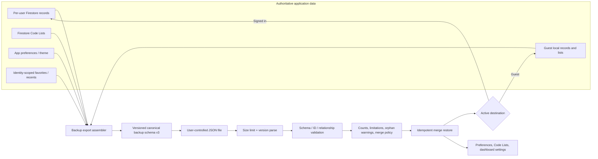

# Backup and Restore — Coverage Review and Target Design

**Review date:** 2026-10-19  
**Scope:** current persistence sources and UI-facing records, current v2 export/import, and implemented v3 backup/restore contract.  
**Important limitation:** source/test review cannot verify deployed Firestore Rules, production data, browser/device behavior, or recover files the application never stored.

## 1. Current Backup Coverage Report

### Data source inventory

| Persisted/runtime source | Contents | Backup handling |
|---|---|---|
| Firestore `users/{uid}/eventGroups` | Moment/event fields plus embedded Activities, Memories, attachment metadata, greeting-card settings, and possibly nested Activity Expenses | Signed-in export reads all event groups. V3 flattens Activities/Memories/attachment metadata with `momentId`, and restore reconstructs event-group records. |
| Firestore `users/{uid}/expenses` | Independent Expenses | Signed-in export reads expenses and reconciles/deduplicates against nested Activity Expenses. V3 exports the effective Expense set and retains stable app IDs. |
| Firestore `users/{uid}/incomes` | Income records | Signed-in export includes all returned records. |
| Firestore `users/{uid}/settings/codelists` | Account Code Lists and schema version | V3 exports current `useAppStore.adminValues` plus `CODE_LIST_SCHEMA_VERSION`; restore writes lists to active account through the store, or guest-local storage. |
| localStorage `lifehub_preferences` | Theme, currency, dashboard view, defaults, notifications, list sort, greeting preferences/templates and other preference fields | V3 explicitly exports the loaded preferences object, not an indiscriminate localStorage dump; restore replaces active browser preferences with backup values merged with safe defaults. These preferences are not currently account-synced. |
| localStorage `lifehub_theme_choice` | Theme selection marker | V3 represents this as `settings.themeChoiceEnabled`; actual theme comes from preferences. |
| `lifehub_favorite_event_ids_{uid|guest|local}` | User's Moment/Event favorites | V3 exports as `dashboardConfiguration.favorites`; restore filters IDs to restored/current Moments and writes to the active identity's key. |
| `lifehub_recent_event_ids_{uid|guest|local}` | Recently selected Moments | V3 exports as `dashboardConfiguration.recent`; restore filters to available Moment IDs and writes to active identity. |
| Guest localStorage event/expense/income keys | Guest records, some embedded; guest expense helper reconciles nested records | Guest export reads the guest services; restore merges local records by app ID and reconstructs relationships. |
| Guest Code Lists keys | Guest custom lists and schema version | V3 exports explicit Code Lists. Legacy v2/legacy settings can be migrated when available. |
| Zustand stores | Runtime copies of records, Code Lists, preferences and derived dashboard state | Stores are not independently persisted. Backup reads domain services for records and the app store for settings; dashboard projections are rebuilt from source records. |
| Development sample fixture keys | Development-only sample dataset/scenario | If active, records export from the sample adapter. Restore is blocked while sample mode is active. Fixture control keys are not part of the v3 recovery contract. |
| Service-worker Cache Storage | Shell/assets | Not user data and not included. |
| Firebase Auth | Identity/session | Credentials and Auth account are intentionally not included and cannot be recreated by a data backup. |
| sessionStorage | Transient chunk-reload marker | Not user/application data; not included. |

### Screen-by-screen coverage

| Screen/data shown | Included? | Source and qualification |
|---|---|---|
| Dashboard | **Yes, derived data; partial configuration** | Dashboard cards/totals are recomputed from restored records and preferences. Favorites/recent selections are backed up. Any future independently persisted dashboard widgets must be added to the explicit schema. |
| Moments | **Yes** | All Moments/event groups and user-authored fields are exported. Firestore document IDs are deliberately excluded; stable application IDs are retained. |
| Activities | **Yes** | Exported separately with `momentId`, then rebuilt into embedded records for the current storage model. |
| Memories | **Yes** | Exported separately with `momentId`, then reconstructed under their Moment. |
| Attachments | **Metadata only — original files NO** | Current app records filename/type/size/date metadata only; it does not retain/upload file bytes or a recoverable object reference. |
| Expenses | **Yes, record data; linked relationships preserved when present** | Effective expenses include top-level and nested copies deduplicated by app ID. Nested Activity expenses rebuild under their Activity; standalone Expenses remain standalone. Orphan links are reported. |
| Income | **Yes** | All service-returned records are included. |
| Settings | **Yes, explicit supported app settings** | Code Lists, user preferences, theme marker, dashboard favorites/recent. Auth identity and transient/sample controls are excluded. Settings stored only in unrecognized future keys require a schema addition. |
| Code Lists | **Yes** | Explicit Firestore/local guest state and schema version. |
| Insights | **Derived, not serialized** | Insights are recomputed from restored records and preferences; there is no separate insights persistence source identified. |

### v2 versus v3

V2 did include Code Lists following the previous task, but exported a broad `lifehub_*` localStorage dump, nested children only inside event groups, weakly validated Code Lists and records, treated any format version >=2 as v2, and skipped whole same-ID Moments (including any missing children). V3 replaces that envelope with explicit top-level domain arrays and configuration. V2 and settings-only legacy backups are normalized during import; unknown declared versions fail closed.

## 2. Missing Items Report

1. **Original attachment bytes:** cannot be backed up or restored because this application does not store them. V3 marks `attachmentDataIncluded: false`; metadata remains recoverable. To meet literal 100% data recovery for files, implement object storage and export policy before claiming complete file recovery.
2. **Firebase Auth account:** not exported or recreated. Restore copies user data/configuration to the currently signed-in UID or guest browser; it cannot recreate login credentials, provider linkage, or the original UID.
3. **Browser-only configuration is not cross-device account state:** preferences/theme and picker configuration are captured from the exporting browser and restored to the importing browser/account context. They are not currently stored in Firestore. This is sufficient for a backup artifact but not automatic multi-device settings synchronization.
4. **Any future new persistence key/collection:** explicit schema requires developers to add it. This is safer than dumping unknown localStorage keys but demands a coverage test/review whenever a new persistence source is added.
5. **Provider/server configuration:** Firestore Rules, Firebase project configuration, service-worker cache, analytics state and secrets are excluded by design. These do not constitute user-authored application records.

There is no separate persisted Dashboard or Insights dataset in current source: dashboard summaries, financial totals and insights are projections over records/settings. If this changes, update v3 schema and tests.

## 3. Restore Risk Assessment

### Prior behavior (v2)

- Restore was additive and skip-by-ID only; same-ID updates/overwrite were never applied.
- Existing same-ID event groups were skipped wholesale, potentially omitting backup Activities/Memories/Attachments absent in the destination.
- Local storage was applied before cloud records and Code Lists; Firestore records were written sequentially. Failure left partial state.
- Individual records and relationships were not fully validated; Code List schema version was not applied.
- Unknown future versions were treated as v2, and restore accepted an absent Code Lists field.
- Local settings used a broad key prefix filter; restoring account-scoped favorite/recent keys could target the wrong identity.
- Firestore-generated document IDs were new on restore; app-level IDs were used for duplicate detection.

### Current v3 behavior and remaining risks

- Parse/validation runs before restore starts: supported version, required arrays/objects, Code List version/entries, stable record IDs, duplicate IDs, and Moment→Activity/Memory/Attachment references are checked. Expense relationships can be soft/orphan references and are warned rather than discarded.
- Restore is **merge**, not replace. Missing records and missing child records are added. Existing same-ID record fields are preserved (no overwrite); configuration is replaced by backup configuration. This is the selected conflict policy and is shown in confirmation UI.
- Restored Activities, Memories, attachments metadata and nested expenses are rebuilt into existing event-group storage. New records are idempotently skipped on retry by app IDs. Same-ID conflict counts are surfaced.
- Writes are still **not atomic** across Firestore records, Code Lists, and browser preferences. Failure can leave a partial restore. Retry is designed to be idempotent, but concurrent user edits during restore are not transactionally isolated. Large Firestore restores are sequential and may be slow; chunked checkpointing and progress UI remain future hardening.
- The 50 MB JSON import cap remains. It is appropriate only while attachments are metadata-only and records remain small. Blob backups need a chunked archive and separate size/quota policy.
- Preferences/theme are browser-local. Restoring them to a new browser persists there; account deletion/recreation by itself will not restore them without importing the file.
- A merge into a non-empty target does not recreate a byte-for-byte identical account: target-only records remain and same-ID target edits win. To recreate an identical account, restore into an empty destination or implement an explicit, destructive replace mode with pre-restore snapshot and transaction/checkpoint safeguards.

### Create / update / overwrite semantics

| Case | Result |
|---|---|
| ID absent in destination | Create record preserving application ID and relationships |
| Same Moment ID | Preserve destination Moment fields; add missing child IDs (Activities, Memories, Attachment metadata, nested linked Expenses) |
| Same Activity/Memory/Attachment/Income/Expense ID | Preserve existing destination record; count as conflict/skip, no silent overwrite |
| Settings/Preferences/Code Lists | Restore backup configuration into active destination; account Code Lists write to Firestore, guest Code Lists to localStorage, preferences to localStorage |
| Target-only record | Keep it (merge semantics) |
| Broken Moment-child reference | Reject backup before writes |
| Orphan finance association | Warn and retain transaction; financial record is not dropped |
| Unsupported future backup version | Reject before restore |

## 4. Required Code Changes / Implemented Changes

- Added `src/services/backupService.js`: v3 schema, explicit export shape, v1/v2 conversion, strict validation, child flatten/reconstruction, relationship warnings, and ID-based merge semantics.
- Updated Settings export to use all current record services plus Code Lists/preferences and explicit active identity favorites/recent lists; no arbitrary localStorage dump.
- Updated restore confirmation and restore path to validate first, display counts/limitations/warnings, merge children into same-ID Moments, preserve same-ID record conflicts, restore app preferences/Code Lists/dashboard configuration, and re-scope picker preferences to the destination identity.
- Added exact preference restoration in `useAppStore`.
- Added `src/services/backupService.test.mjs`, covering v3 export, relationship reconstruction, validation, v2 migration, idempotent child merge, orphan warnings, and the requested 50/100/200/20/500/100 round-trip volume.
- Existing guest/auth service paths remain the persistence adapters; no new data collection was introduced.

## 5. Firestore/localStorage Reconciliation Strategy

### Export source of truth

- Authenticated user records: Firestore services scoped to the active UID. Any read failure aborts export; do not substitute empty/default arrays for failed remote reads.
- Guest records: guest services/localStorage.
- Active development fixtures: isolated sample data only; not mixed with account or guest data.
- Code Lists: current hydrated account Code Lists for signed-in users; guest store for guest mode.
- Preferences: current hydrated Zustand preferences (browser-local today).
- Dashboard favorites/recent: keys scoped to current UID/guest/local ID only.
- Never infer that local Code Lists override an existing account Firestore document. The store’s hydrated Firestore state is authoritative.

### Restore precedence

- User records merge into the currently active identity; source backup UID is provenance only, not a destination selector.
- Existing same-ID records win; backup adds only missing records/children. This avoids destructive overwrite but is not a replacement restore.
- Backup Code Lists/preferences/configuration win over destination configuration because user explicitly chose restore.
- Guest records persist locally; account records write to Firestore under current UID.
- Never copy source `lifehub_*` keys wholesale. Explicitly map approved settings and remap identity-scoped dashboard keys.

## 6. Updated Backup Architecture

Canonical envelope keys: `backupVersion`, `createdDate`, `moments`, `activities`, `memories`, `attachments`, `expenses`, `incomes`, `codeLists`, `codeListSchemaVersion`, `settings`, `preferences`, `dashboardConfiguration`, and `metadata`.

Attachment file bytes and auth credentials are deliberately absent and explicitly disclosed. If binary attachments are implemented, extend the envelope with object manifests/content hashes and an archive format designed for large files; do not place blobs/base64 in event documents or unbounded JSON.

## 7. Final Recovery Test Plan

### Automated

1. Generate a backup with 50 Moments, 100 Activities, 200 Memories, 20 attachment metadata records, 500 Expenses and 100 Income records; assert all counts and references survive parse/reconstruction.
2. Verify settings, theme/preferences, Code Lists, Code List schema version, dashboard favorites/recent, and metadata round-trip.
3. Verify source Firestore document IDs and auth credentials are not serialized.
4. Verify duplicate IDs, malformed lists, invalid version, missing arrays, bad required Moment references, invalid timestamps, oversized import and malformed JSON fail before any write.
5. Verify v1 settings-only and v2 application backups upgrade, and unknown future formats fail closed.
6. Verify same-ID conflicts preserve existing fields, missing children are added, retry adds nothing a second time, and orphan finance links are reported but not lost.
7. Verify Firestore read failure aborts export rather than generating a misleading partial backup.
8. Verify guest export/restore writes only guest data; signed-in restore writes only current UID and never copies source localStorage keys.

### Manual Firebase/device recovery drill

1. On account A, create the acceptance dataset and configuration; export and preserve the backup outside the browser.
2. Verify exported counts/metadata and inspect that file bytes and auth credentials are correctly disclosed/absent.
3. Delete the test account using the supported account-deletion process; create a fresh empty account B.
4. Restore to B; verify the preview counts, Code Lists in `users/{B}/settings/codelists`, all records, application IDs, Moment-child relationships, expense links, preferences/theme, and dashboard favorites/recent.
5. Open B on another browser/device and verify Firestore records and Code Lists; confirm preference sync limitations are understood (preferences currently remain browser-local).
6. Retry the same backup; verify no duplicate records and same-ID values remain unchanged.
7. Repeat with a partially interrupted restore and with a corrupted/unsupported backup; ensure the UI reports partial completion and the retry completes safely.
8. Perform the same test in guest mode, clear local browser data only after preserving the file, restore, and verify guest records/settings.
9. Confirm actual attachment original-file recovery is **not** passed until a real file-storage feature exists; metadata-only behavior is the current expected result.

No live Firebase/account-deletion test has been run in this source review. A successful build/unit suite does not prove production Rules, account recreation, multi-device behavior, or failure recovery.
